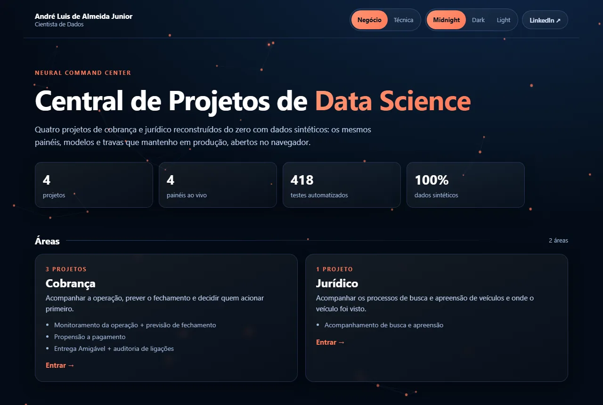
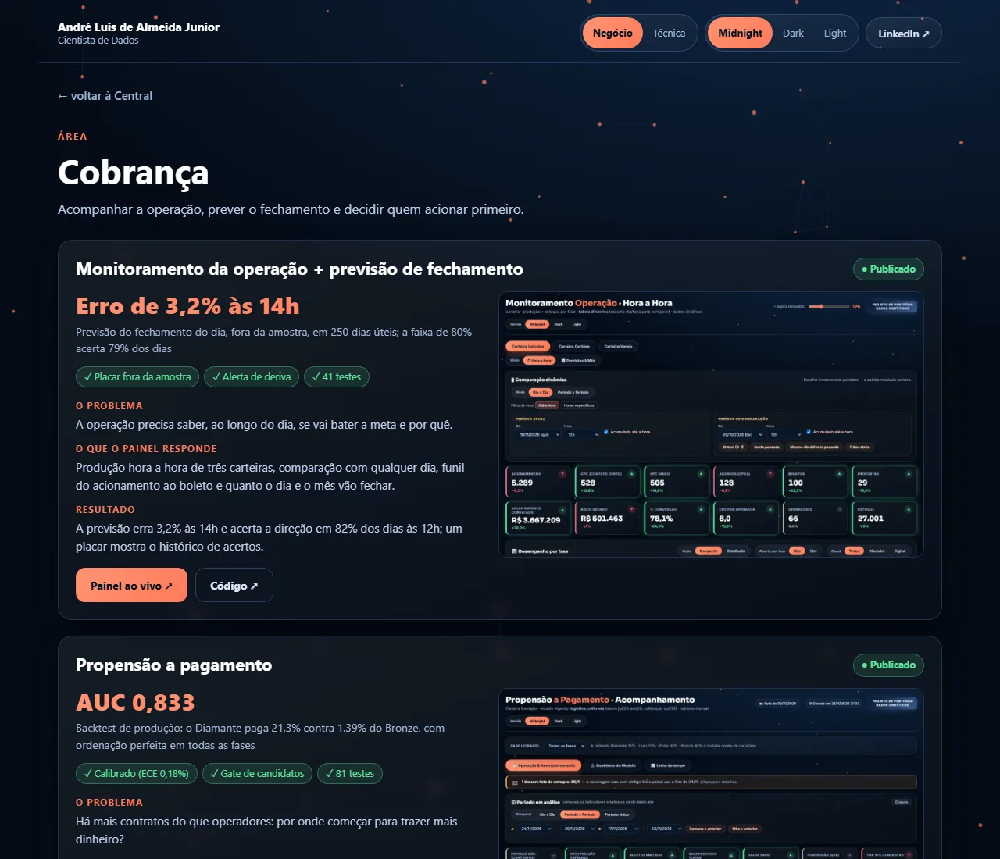

# Central de Projetos de Data Science

**Site:** https://alajunior.github.io/ · André Luis de Almeida Junior, Cientista de Dados · [LinkedIn](https://www.linkedin.com/in/andr%C3%A9-junior-338767262)

Um link só para os quatro projetos do meu portfólio de cobrança e jurídico. A Central é a réplica do lançador interno que uso no trabalho para reunir os modelos e painéis da operação: uma página inicial com as áreas, uma página por área e um card por projeto, com a métrica principal, os selos de validação, o painel ao vivo e o código.

Um botão no topo troca o nível de detalhe:
- **Negócio:** o problema, o que o painel responde e o resultado, sem jargão.
- **Técnica:** a técnica, como foi validado, os destaques de engenharia, o número de testes e a stack.

> Todos os projetos usam **dados 100% sintéticos** e foram reescritos do zero. Nenhum dado real de cliente ou de empresa.



## Os projetos

| Área | Projeto | Em uma linha | Painel | Código |
|---|---|---|---|---|
| Cobrança | Monitoramento da operação + previsão de fechamento | Produção hora a hora e quanto o dia e o mês vão fechar, com placar de acertos fora da amostra | [abrir](https://alajunior.github.io/monitoramento-operacao-cobranca/) | [repo](https://github.com/Alajunior/monitoramento-operacao-cobranca) |
| Cobrança | Propensão a pagamento | Logística calibrada que ordena a fila por valor esperado, com travas de produção | [abrir](https://alajunior.github.io/propensao-pagamento-cobranca/) | [repo](https://github.com/Alajunior/propensao-pagamento-cobranca) |
| Cobrança | Entrega Amigável + auditoria de ligações | Classe rara (< 1%) e auditoria de 60 ligações transcritas, medida contra gabarito | [abrir](https://alajunior.github.io/entrega-amigavel-cobranca/) | [repo](https://github.com/Alajunior/entrega-amigavel-cobranca) |
| Jurídico | Acompanhamento de busca e apreensão | Painel jurídico com regra de etapas, travas, conciliação e padrões de placa | [abrir](https://alajunior.github.io/acompanhamento-busca-apreensao/) | [repo](https://github.com/Alajunior/acompanhamento-busca-apreensao) |



## Como funciona

| Parte | Como | Onde |
|---|---|---|
| **Fonte única** | Todo o conteúdo (projetos, métricas, selos, textos das duas visões) fica em um JSON. Trocar um número é editar uma linha | [`manifest.json`](manifest.json) |
| **Build** | Python só com a biblioteca padrão gera HTML pronto: a página abre e se lê mesmo sem JavaScript, e todo texto do manifest sai escapado | [`build.py`](build.py), [`modelos/`](modelos/) |
| **Visual** | HTML, CSS e JS puros. Temas Midnight, Dark e Light (os mesmos dos painéis), fundo de rede neural em canvas que pausa com a aba em segundo plano e vira um quadro parado com `prefers-reduced-motion`. Funciona no celular | [`estatico/`](estatico/) |
| **Testes** | O manifest tem a estrutura certa e nenhum e-mail; o número de testes de cada projeto bate com o README dele (quando os repositórios estão lado a lado); todo link interno de cada página existe; o `docs/` está em dia com o build; e uma guarda barra qualquer termo de empresa real | [`tests/`](tests/) |
| **CI** | A cada push: refaz o build e falha se o `docs/` versionado mudou, roda os testes e publica no GitHub Pages | [`.github/workflows/ci.yml`](.github/workflows/ci.yml) |

**Decisões:** sem framework (o site é pequeno e precisa abrir rápido); sem rastreamento de visitas, formulário ou e-mail (o contato é pelo LinkedIn); os números vêm dos READMEs dos projetos e um teste garante que não se descolam.

## Como rodar

```bash
pip install -r requirements.txt
python build.py                        # gera docs/index.html e docs/area/*.html
python -m pytest                       # 19 testes
python -m http.server --directory docs # abre em http://localhost:8000
```

## Estrutura

```
manifest.json      conteúdo: identificação, números, áreas, projetos (visões Negócio e Técnica)
build.py           manifest → docs/ (HTML pronto)
modelos/           base, home e área (string.Template)
estatico/          estilo.css e central.js (copiados para docs/ pelo build)
docs/              o site publicado; docs/img traz uma captura de cada painel
capturas/          imagens deste README
tests/             manifest, build e guarda de publicação
```
